<div align="center">

<picture>
  <source media="(prefers-color-scheme: light)" srcset="docs/banner-light.png">
  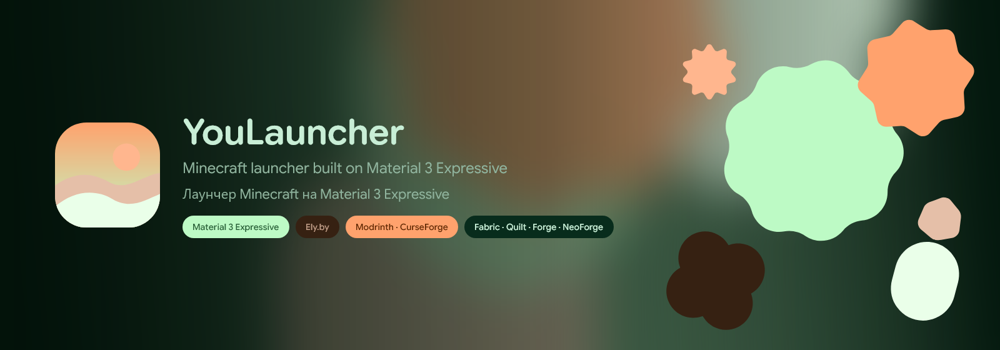
</picture>

<br>

[](../../releases/latest)


[](LICENSE)


**[English](#-english)** &nbsp;•&nbsp; **[Русский](#-русский)**

<sub>Unofficial launcher, not affiliated with Mojang or Microsoft · Неофициальный лаунчер, не связан с Mojang и Microsoft</sub>

</div>

<br>

<div align="center">
  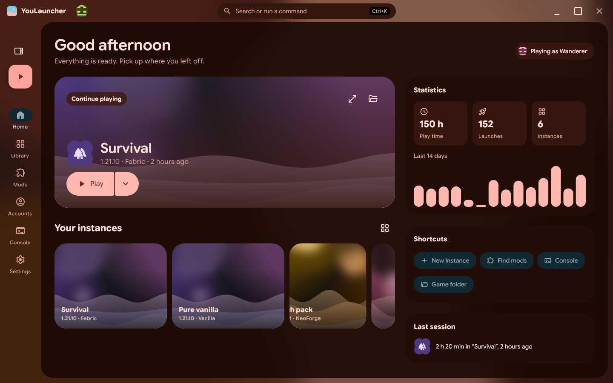
</div>

<br>

---

## 🌍 English

### A launcher that feels like a modern Android app

**YouLauncher** is a Minecraft: Java Edition launcher for Windows with a **complete Material 3 Expressive integration**. Not a theme on top of an old interface: every button, card, menu, indicator and transition is a native M3 Expressive component that springs, morphs and reacts to you. Colors are generated dynamically from a single seed, from your wallpaper or from the version you are about to play, and you can recolor every single element.

### ✨ Material 3 Expressive, all the way

<table>
<tr>
<td width="50%" valign="top">

**🌀 Springy motion**<br>
Every animation is a physical spring from the M3 motion scheme. Pick how bouncy it feels: *Standard*, *Bouncy* or *Jelly*.

**🔷 Shape morphing**<br>
Buttons change shape when pressed, loading indicators morph between M3 shapes, progress bars are wavy.

**🎨 Dynamic color**<br>
The whole palette is built from one seed color, from your wallpaper, or from the game version you pick.

</td>
<td width="50%" valign="top">

**🖌️ Your color for every element**<br>
All 35 color roles of the M3 scheme can be set individually: tonal palettes, HCT sliders, HEX, live WCAG contrast check.

**🌄 Living backgrounds**<br>
28 built-in wallpapers and live backgrounds drawn by code, depth parallax, blur, your own pictures — even a separate one for each instance.

**🏷️ Version emblems**<br>
The key feature of each Minecraft update is drawn as a composition of M3 shapes in the version picker.

</td>
</tr>
</table>

<div align="center">
  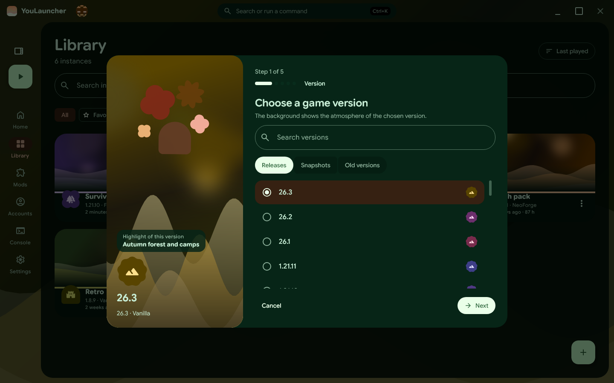
  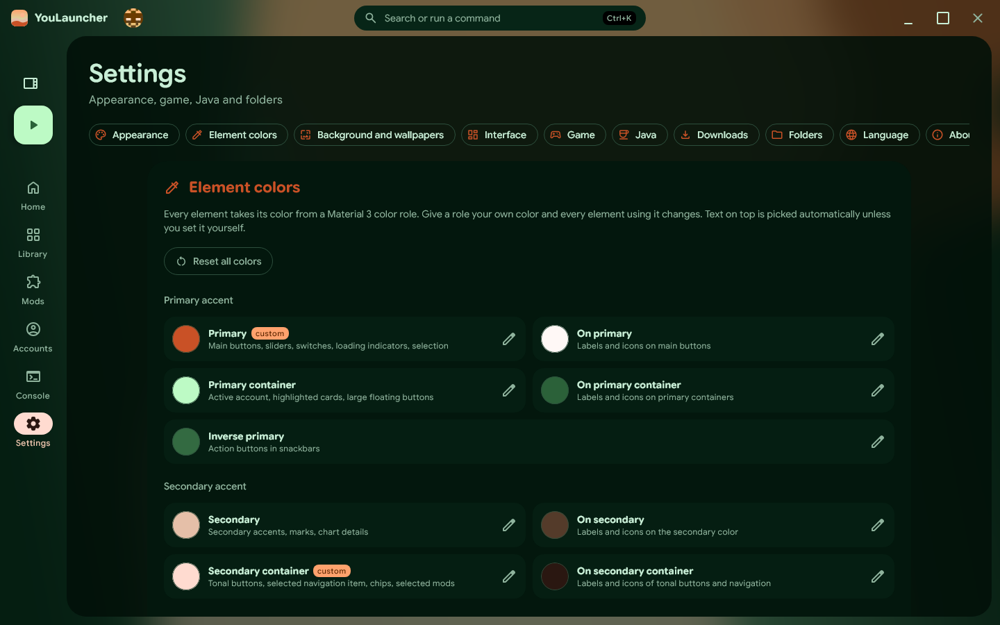
  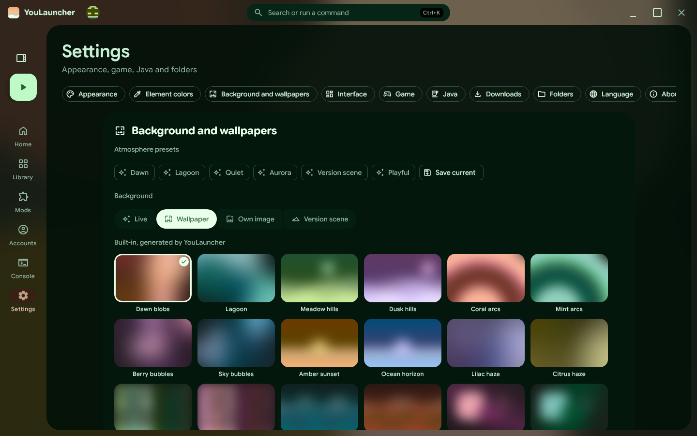
  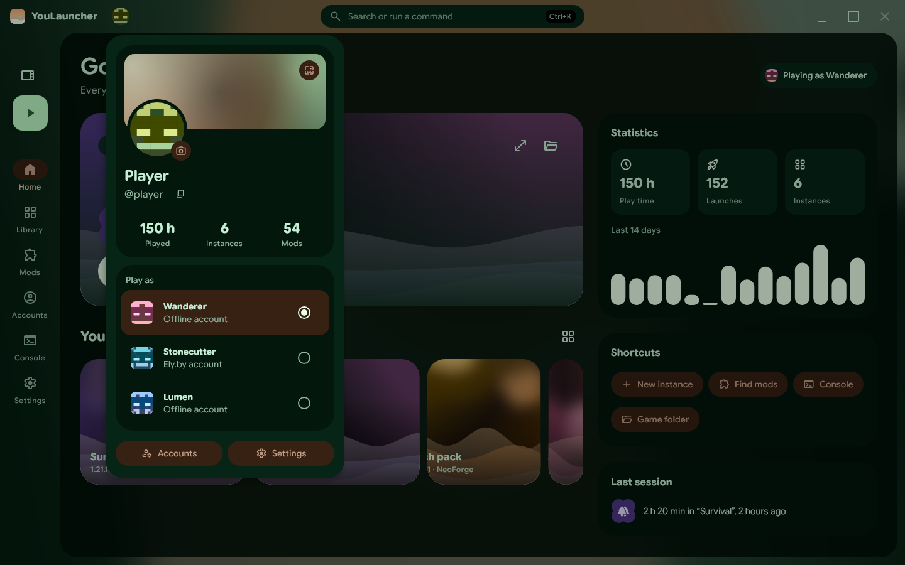
</div>

### 🎮 Everything for playing

- **Any version** — releases, snapshots and old versions, downloaded only from official Mojang servers and verified with SHA-1.
- **Mod loaders** — Fabric, Quilt, Forge and NeoForge, with version choice and one-click loader updates.
- **Mods, resource packs, shaders and modpacks** from **Modrinth** and **CurseForge**: a dependency window before installing, multi-select with one *Install all* dialog, update checks, mod sets.
- **Modpacks** — import `.mrpack`, CurseForge and MultiMC/Prism; export to `.mrpack` and Prism.
- **Accounts** — offline, **Ely.by** (skins, two-factor sign-in) and **Microsoft** (official servers and Realms; the password is entered only on the Microsoft website). Tokens are stored in Windows Credential Manager, the password is never saved.
- **Instances** — change the game version with a mod compatibility check, repair files, scheduled backups, servers from `servers.dat` with ping, screenshots and worlds.
- **Java** — picked automatically for every version, downloaded from Mojang or Eclipse Temurin.
- **Comfort** — command palette (`Ctrl+K`), hotkeys, compact and mini window modes, Windows notifications, auto-update with hash check, English and Russian.
- **Light on memory** — about 250–300 MB of RAM with all the animations on.

<div align="center">
  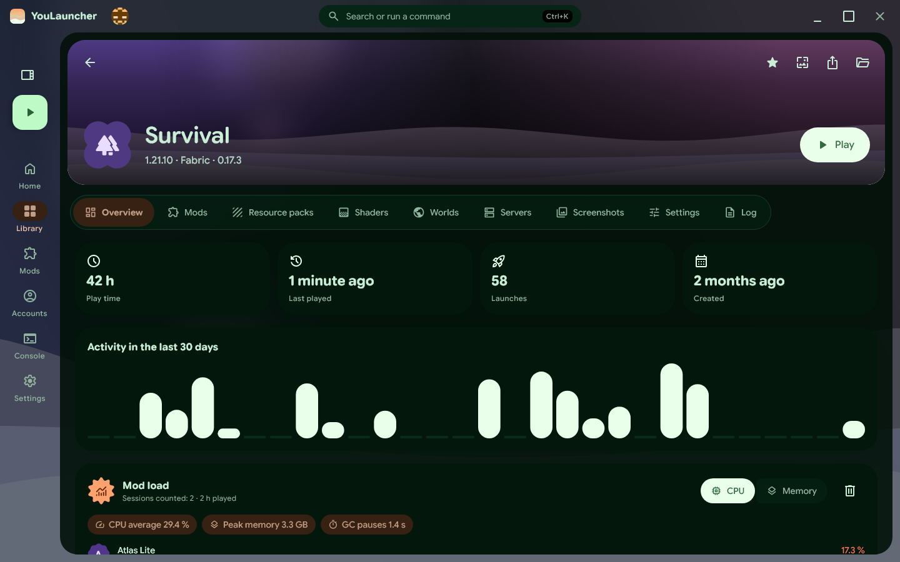
  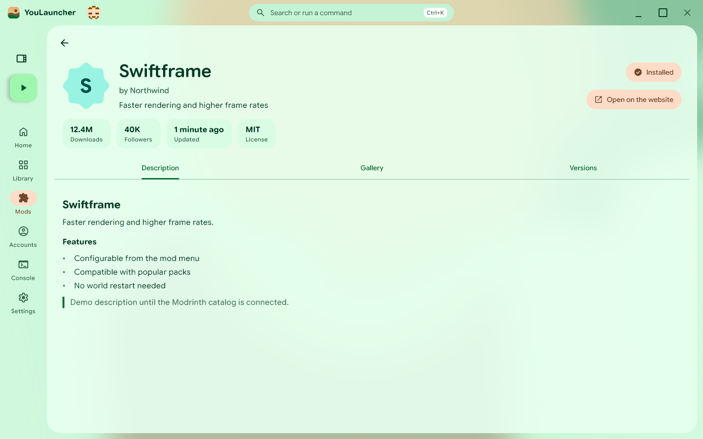
  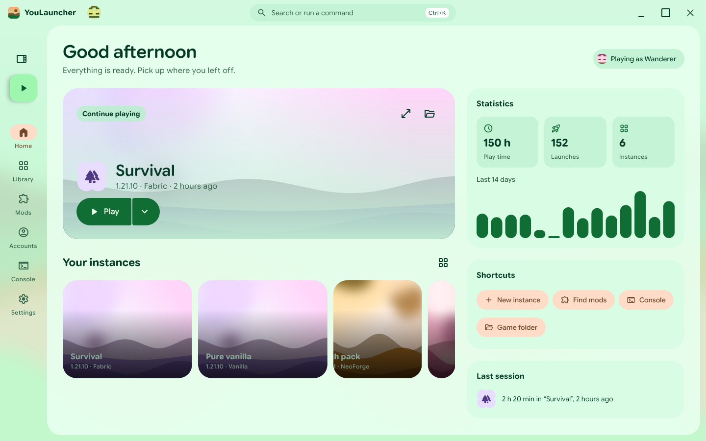
  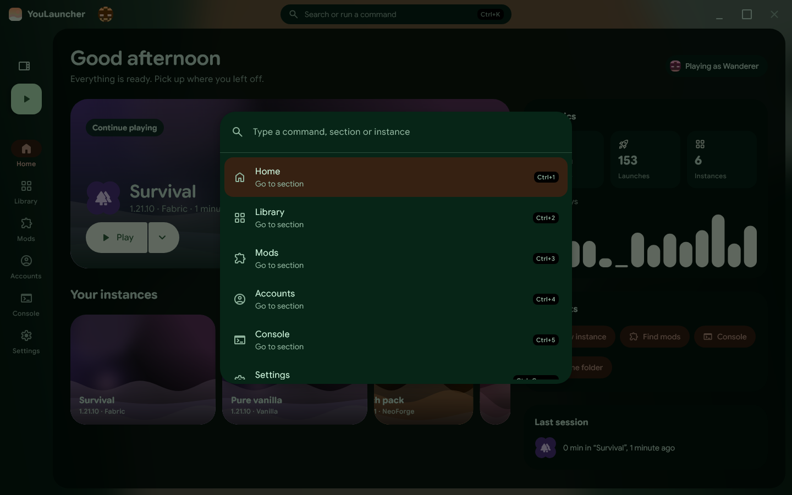
</div>

### 💿 The installer is Material 3 too

<picture>
  <source media="(prefers-color-scheme: light)" srcset="docs/screens/setup/en/showcase-light.png">
  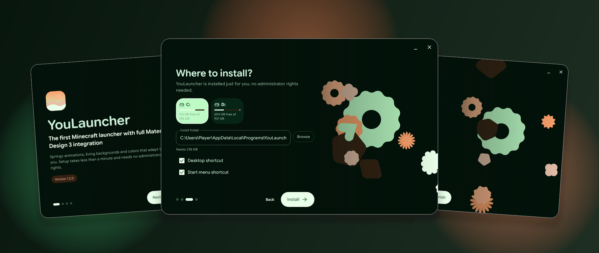
</picture>

Even installing YouLauncher looks like the launcher itself: a living background of M3 shapes and spinning gears, shapes that morph from step to step, springy transitions. **Welcome → What's inside → Pick a drive → Installing → Done.** Under a minute, no admin rights.

### 📥 Download

<table>
<tr>
<th width="50%">💿 Installer &nbsp;<sup>recommended</sup></th>
<th width="50%">📦 Portable</th>
</tr>
<tr>
<td align="center" valign="top">
<br>
<code>YouLauncher-&lt;version&gt;-Setup.exe</code>
<br><br>
Run it, pick a drive and a folder, done.<br>Shortcuts and an entry in Windows <i>Apps</i> included.
<br><br>
<a href="../../releases/latest"></a>
<br><br>
</td>
<td align="center" valign="top">
<br>
<code>YouLauncher-&lt;version&gt;-windows.zip</code>
<br><br>
Unzip anywhere and run<br><code>YouLauncher-App\YouLauncher.exe</code>.
<br><br>
<a href="../../releases/latest"></a>
<br><br>
</td>
</tr>
</table>

| | 💿 Installer | 📦 Portable |
|---|:---:|:---:|
| How to start | Material 3 setup wizard | Unzip and run the `.exe` |
| Choose drive and folder | ✅ with a free-space check | ✅ wherever you unzip it |
| Desktop and Start menu shortcuts | ✅ | — |
| Listed in Windows *Apps*, uninstall from there | ✅ | — (just delete the folder) |
| Admin rights | not needed | not needed |
| Java bundled | ✅ | ✅ |
| Auto-update | ✅ | ✅ |
| Where your data lives | `%APPDATA%\YouLauncher` | `%APPDATA%\YouLauncher`, or a `data` folder beside the `.exe` if you add an empty `portable.txt` |

Uninstalling keeps your instances, worlds and settings unless you tick *Also remove my data*, so a reinstall brings everything back.
<details>
<summary><b>🛠️ Build from source</b></summary>

<br>

Requires JDK 21 (Gradle can download it for you).

```bat
gradlew.bat run          :: run from sources
gradlew.bat test         :: unit tests
gradlew.bat exportApp    :: portable build in YouLauncher-App\YouLauncher.exe
gradlew.bat exportZip    :: YouLauncher-<version>-windows.zip
gradlew.bat packageSetup :: YouLauncher-<version>-Setup.exe (Material 3 installer)
gradlew.bat packageMsi   :: MSI installer
```

| Option | How | Purpose |
|---|---|---|
| CurseForge API key | env `YOULAUNCHER_CURSEFORGE_KEY` | Embeds the key so the CurseForge catalog works for everyone. Without it users can enter their own key in Settings. |
| Update repository | `-PupdateRepo=owner/repo` or env `YOULAUNCHER_UPDATE_REPO` | The launcher checks this repository's releases for updates. |
| Microsoft sign-in | `-PmsClientId=<id>` or env `YOULAUNCHER_MS_CLIENT_ID` | Application (client) ID of your Azure app (personal accounts, public client flows on). Mojang must approve the app for the Minecraft API: [request form](https://aka.ms/mce-reviewappid). Without the ID the Microsoft button is hidden. |
| Version | `-PappVersion=v1.2.0` | Overrides the version from `build.gradle.kts`. |

Launch arguments: `YouLauncher.exe --launch <instance-id>` starts an instance right away (used by desktop shortcuts), `--open <screen>` opens a screen (`home`, `library`, `mods`, `accounts`, `console`, `settings`, `settings:<section>`, `instance:<id>`, `profile`).

</details>

---

## 🌏 Русский

### Лаунчер, который ощущается как современное Android-приложение

**YouLauncher** — лаунчер Minecraft: Java Edition для Windows с **полной интеграцией Material 3 Expressive**. Это не тема поверх старого интерфейса: каждая кнопка, карточка, меню, индикатор и переход — родной компонент M3 Expressive, который пружинит, меняет форму и откликается на каждое действие. Цвета строятся динамически из одного цвета, из ваших обоев или из версии игры, а перекрасить можно любой элемент.

### ✨ Material 3 Expressive от и до

<table>
<tr>
<td width="50%" valign="top">

**🌀 Пружинные анимации**<br>
Каждое движение — физическая пружина из схемы движения M3. Упругость на выбор: *Стандарт*, *Упругие* или *Желе*.

**🔷 Морфинг форм**<br>
Кнопки меняют форму при нажатии, индикаторы загрузки перетекают между формами M3, полосы прогресса волнистые.

**🎨 Динамический цвет**<br>
Вся палитра строится из одного цвета, из ваших обоев или из выбранной версии игры.

</td>
<td width="50%" valign="top">

**🖌️ Свой цвет для каждого элемента**<br>
Все 35 цветовых ролей схемы M3 настраиваются по отдельности: тональные палитры, ползунки HCT, HEX, проверка контраста WCAG.

**🌄 Живые фоны**<br>
28 встроенных обоев и живые фоны, нарисованные кодом, параллакс по глубине, размытие, свои картинки — даже отдельные для каждого экземпляра.

**🏷️ Эмблемы версий**<br>
Главная новинка каждого обновления Minecraft нарисована композицией из форм M3 прямо в выборе версии.

</td>
</tr>
</table>

<div align="center">
  
  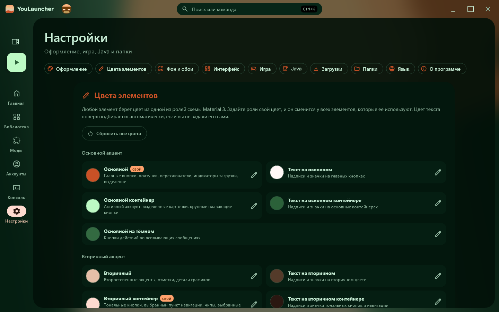
  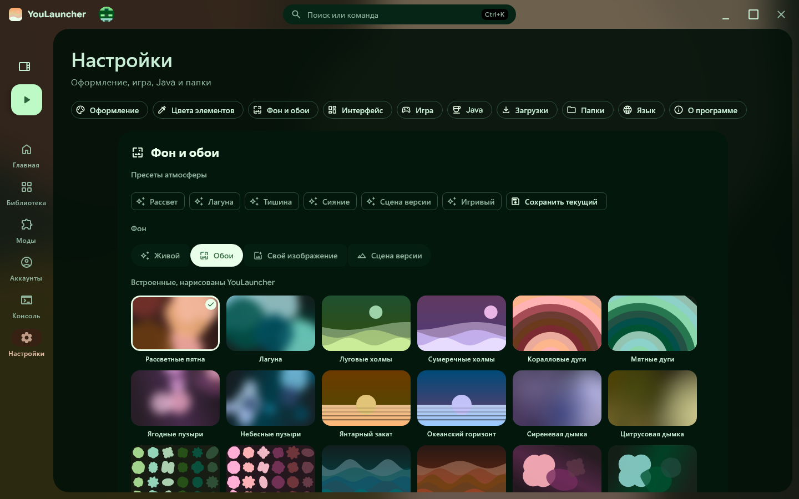
  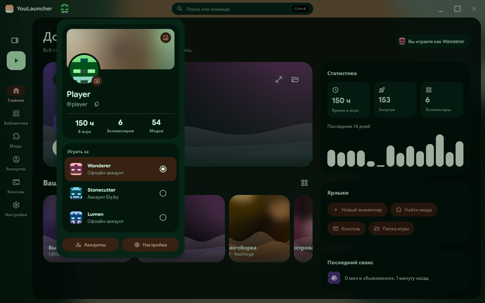
</div>

### 🎮 Всё для игры

- **Любая версия** — релизы, снапшоты и старые версии, только с официальных серверов Mojang, с проверкой SHA-1.
- **Загрузчики модов** — Fabric, Quilt, Forge и NeoForge, выбор версии и обновление загрузчика в один клик.
- **Моды, ресурспаки, шейдеры и сборки** из **Modrinth** и **CurseForge**: окно зависимостей перед установкой, выбор нескольких модов галочками и одно окно «Установить всё», проверка обновлений, наборы модов.
- **Сборки** — импорт `.mrpack`, CurseForge и MultiMC/Prism; экспорт в `.mrpack` и Prism.
- **Аккаунты** — офлайн, **Ely.by** (скины, двухфакторная защита) и **Microsoft** (официальные серверы и Realms; пароль вводится только на сайте Microsoft). Токены хранятся в диспетчере учётных данных Windows, пароль не сохраняется.
- **Экземпляры** — смена версии игры с проверкой модов, починка файлов, резервные копии по расписанию, серверы из `servers.dat` с пингом, скриншоты и миры.
- **Java** — подбирается под каждую версию автоматически, скачивается с серверов Mojang или Eclipse Temurin.
- **Удобство** — палитра команд (`Ctrl+K`), горячие клавиши, компактный и мини-режим окна, уведомления Windows, автообновление с проверкой хеша, русский и английский языки.
- **Лёгкий** — около 250–300 МБ памяти со всеми анимациями.

<div align="center">
  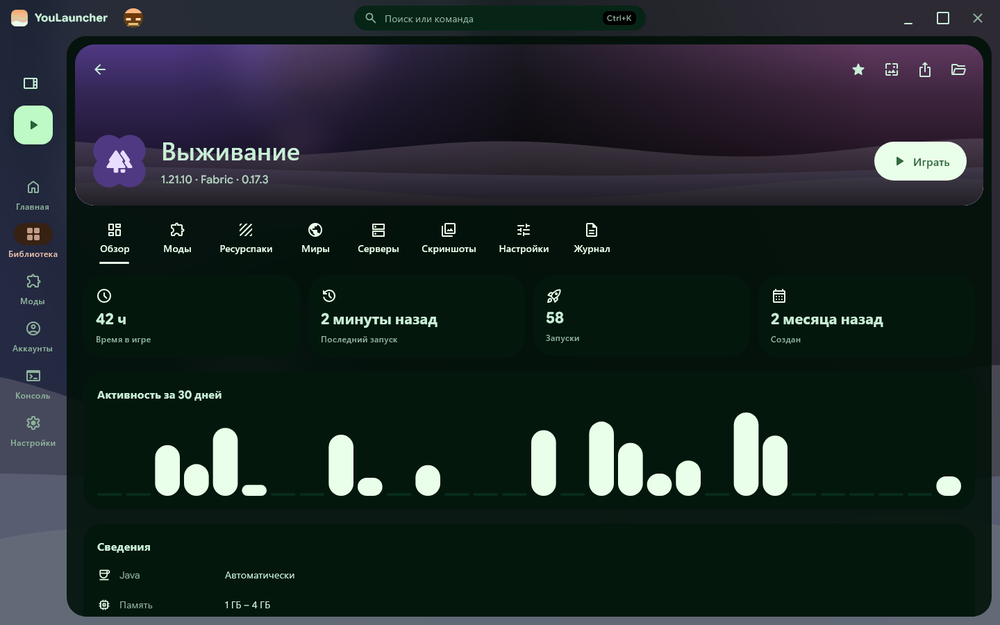
  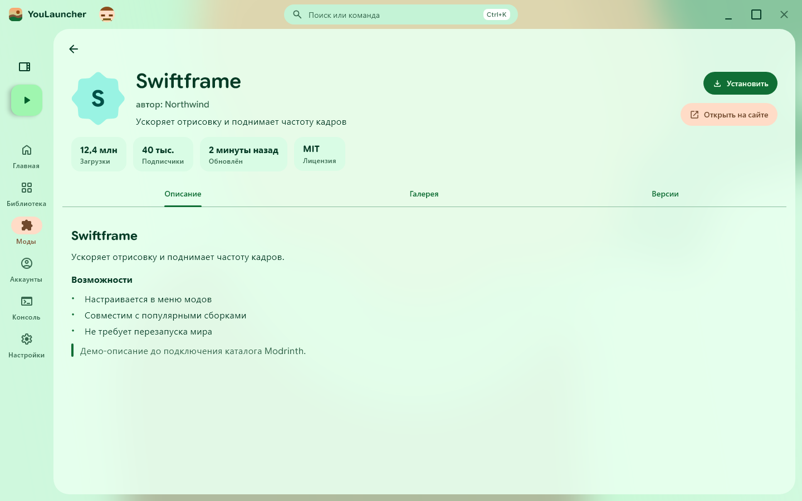
  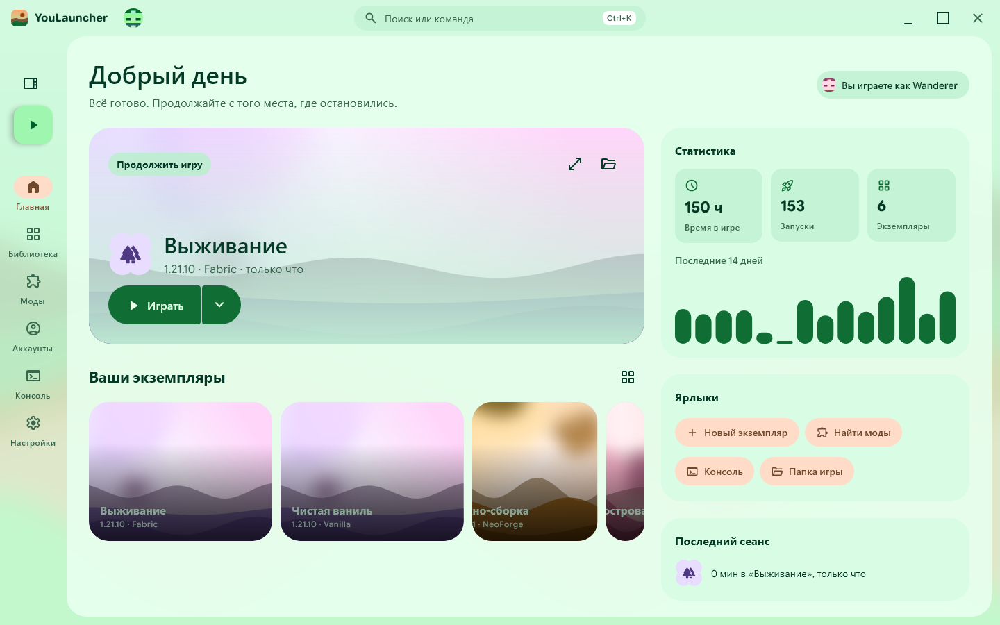
  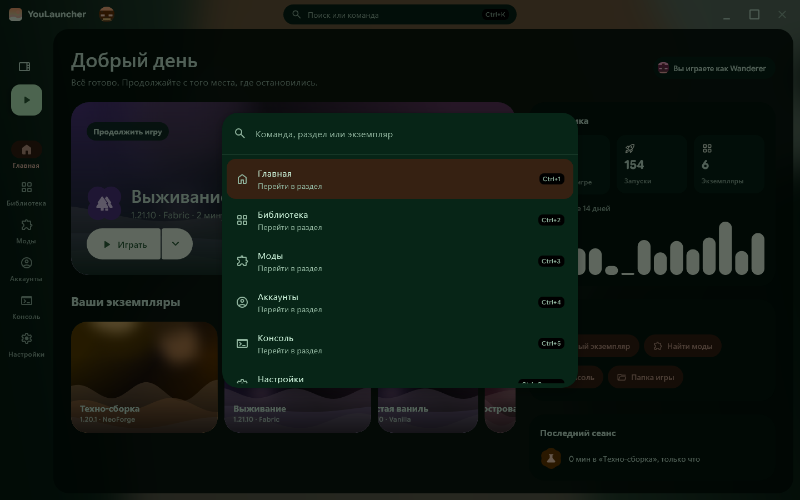
</div>

### 💿 Установщик тоже в Material 3

<picture>
  <source media="(prefers-color-scheme: light)" srcset="docs/screens/setup/showcase-light.png">
  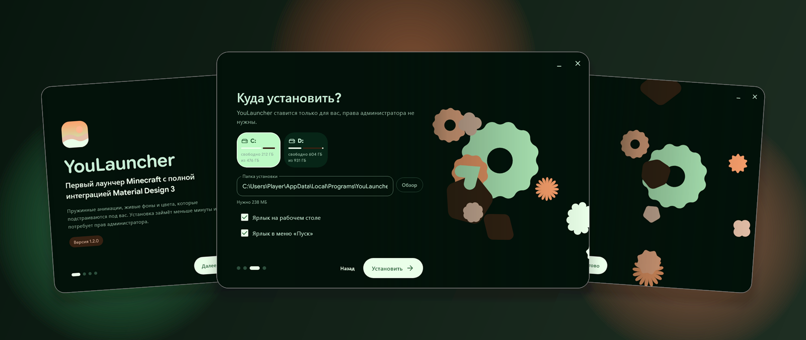
</picture>

Даже установка выглядит как сам лаунчер: живой фон из фигур M3 и вращающихся шестерёнок, фигуры перетекают из шага в шаг, пружинные переходы. **Приветствие → Возможности → Выбор диска → Установка → Готово.** Меньше минуты, без прав администратора.

### 📥 Скачать

<table>
<tr>
<th width="50%">💿 Установщик &nbsp;<sup>рекомендуем</sup></th>
<th width="50%">📦 Портативная версия</th>
</tr>
<tr>
<td align="center" valign="top">
<br>
<code>YouLauncher-&lt;версия&gt;-Setup.exe</code>
<br><br>
Запустите, выберите диск и папку — готово.<br>Ярлыки и запись в «Приложениях» Windows в комплекте.
<br><br>
<a href="../../releases/latest"></a>
<br><br>
</td>
<td align="center" valign="top">
<br>
<code>YouLauncher-&lt;версия&gt;-windows.zip</code>
<br><br>
Распакуйте в любую папку и запустите<br><code>YouLauncher-App\YouLauncher.exe</code>.
<br><br>
<a href="../../releases/latest"></a>
<br><br>
</td>
</tr>
</table>

| | 💿 Установщик | 📦 Портативная |
|---|:---:|:---:|
| Как начать | Мастер установки в Material 3 | Распаковать и запустить `.exe` |
| Выбор диска и папки | ✅ с проверкой свободного места | ✅ куда распакуете |
| Ярлыки на рабочем столе и в «Пуске» | ✅ | — |
| Есть в «Приложениях» Windows, удаление оттуда | ✅ | — (просто удалить папку) |
| Права администратора | не нужны | не нужны |
| Java внутри | ✅ | ✅ |
| Автообновление | ✅ | ✅ |
| Где хранятся данные | `%APPDATA%\YouLauncher` | `%APPDATA%\YouLauncher` или папка `data` рядом с `.exe`, если положить пустой `portable.txt` |

При удалении экземпляры, миры и настройки остаются, если не отметить «Удалить и мои данные», — после переустановки всё вернётся.
<details>
<summary><b>🛠️ Сборка из исходников</b></summary>

<br>

Нужен JDK 21 (Gradle может скачать его сам).

```bat
gradlew.bat run          :: запуск из исходников
gradlew.bat test         :: тесты
gradlew.bat exportApp    :: портативная сборка в YouLauncher-App\YouLauncher.exe
gradlew.bat exportZip    :: архив YouLauncher-<версия>-windows.zip
gradlew.bat packageSetup :: YouLauncher-<версия>-Setup.exe (установщик в Material 3)
gradlew.bat packageMsi   :: установщик MSI
```

| Параметр | Как задать | Зачем |
|---|---|---|
| Ключ CurseForge API | переменная `YOULAUNCHER_CURSEFORGE_KEY` | Ключ встраивается в сборку, и каталог CurseForge работает у всех. Без него пользователь может ввести свой ключ в настройках. |
| Репозиторий обновлений | `-PupdateRepo=владелец/репозиторий` или `YOULAUNCHER_UPDATE_REPO` | Лаунчер проверяет релизы этого репозитория. |
| Вход через Microsoft | `-PmsClientId=<id>` или `YOULAUNCHER_MS_CLIENT_ID` | ID приложения Azure (личные аккаунты, включены public client flows). Mojang должна одобрить приложение для Minecraft API: [форма заявки](https://aka.ms/mce-reviewappid). Без ID кнопки входа через Microsoft нет. |
| Версия | `-PappVersion=v1.2.0` | Вместо версии из `build.gradle.kts`. |

Аргументы запуска: `YouLauncher.exe --launch <id>` сразу запускает экземпляр (так работают ярлыки на рабочем столе), `--open <экран>` открывает экран (`home`, `library`, `mods`, `accounts`, `console`, `settings`, `settings:<раздел>`, `instance:<id>`, `profile`).

</details>

---

<div align="center">

### 🖼️ Gallery · Галерея

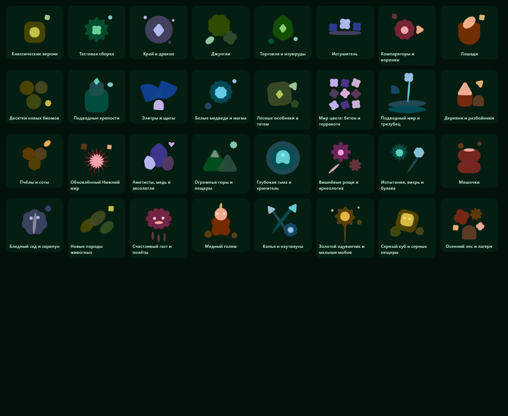
<br><sub>Version emblems drawn from Material 3 shapes · Эмблемы версий из форм Material 3</sub>
<br><br>
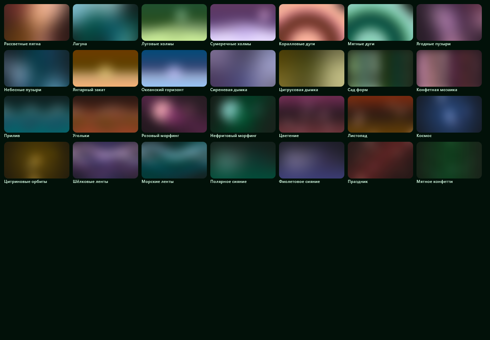
<br><sub>Built-in wallpapers, drawn by code · Встроенные обои, нарисованные кодом</sub>

</div>

---

<div align="center">

Made by **Eroun97** together with **Claude** (Anthropic) · Создан **Eroun97** вместе с **Claude** (Anthropic)

</div>

---

<div align="center">

**License · Лицензия — [MIT](LICENSE)**: use it, change it, build your own launcher on top of it · берите, меняйте и делайте на его основе своё.
Third-party components are listed in [NOTICE](NOTICE) · сторонние компоненты перечислены в [NOTICE](NOTICE).
Icons: Material Symbols (Apache 2.0) · Fonts: Google Sans Flex, Google Sans Code (OFL 1.1).

<sub>“Minecraft” is a trademark of Mojang Synergies AB. YouLauncher is not affiliated with or endorsed by Mojang or Microsoft and does not distribute game files: they are downloaded from official Mojang servers on your computer.<br>
«Minecraft» — товарный знак Mojang Synergies AB. YouLauncher не связан с Mojang и Microsoft и не распространяет файлы игры: они скачиваются с официальных серверов Mojang на вашем компьютере.</sub>

</div>
